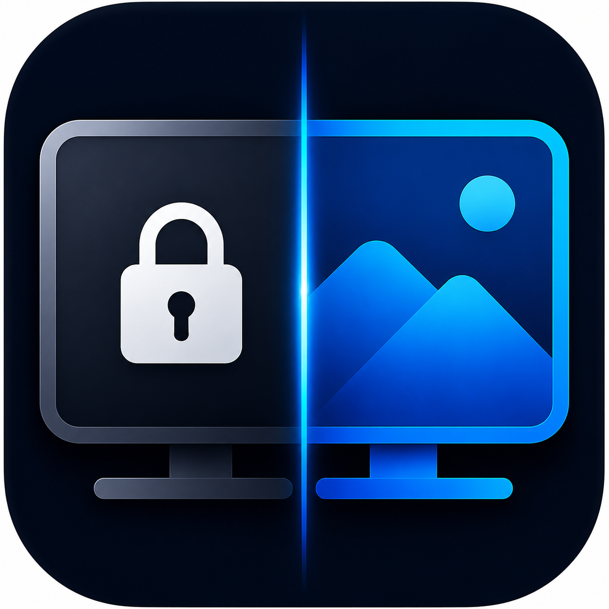
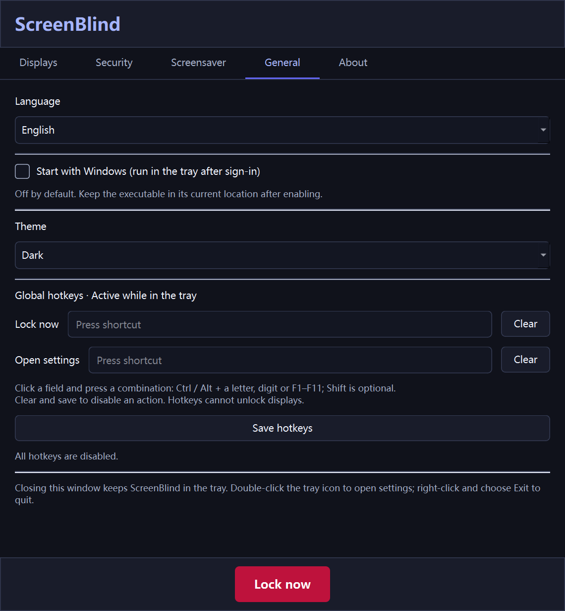
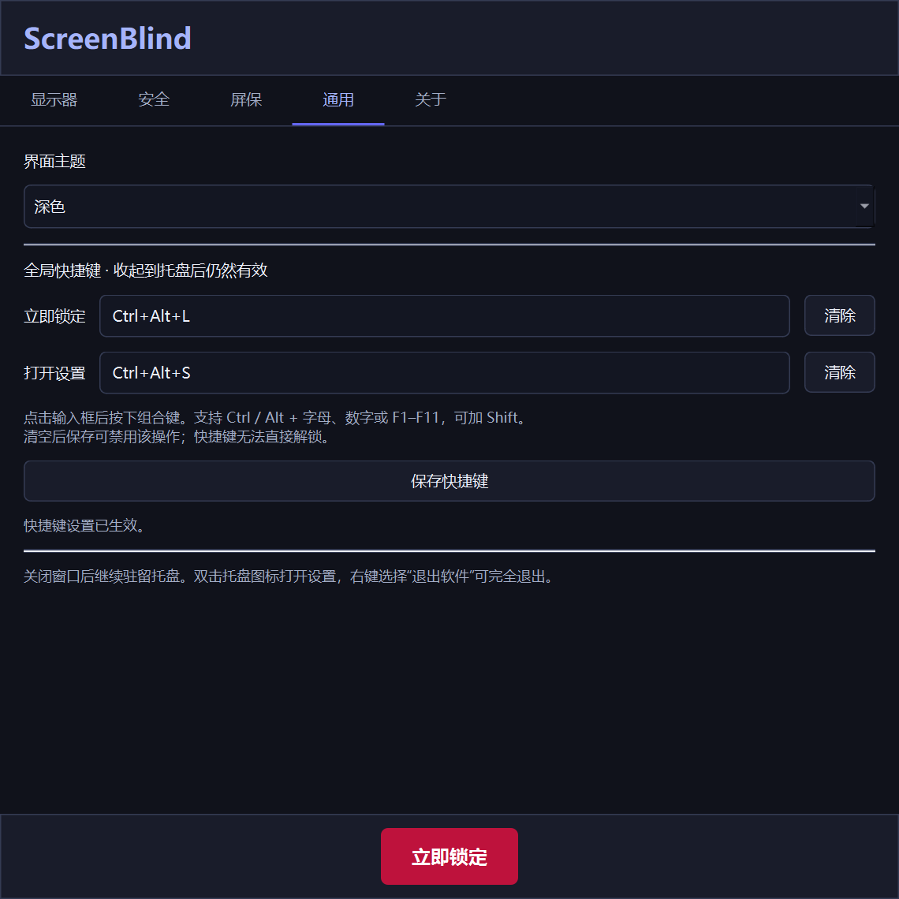

<div align="center">



# ScreenBlind

[English](README.md) · [简体中文](README.zh-CN.md)

**Lock what others shouldn't see. Unlock what matters.**

Selective multi-monitor lock screen for Windows.
Cover the screens you choose — let the others keep showing what's on them.

[Website](https://screenblind.cc) · [Download](#installation) · [Donate ❤](#support)

</div>

---

## What it does

ScreenBlind lets you lock **individual monitors** on a multi-display Windows
setup. The locked screens go dark and require a password to wake — the
unlocked ones stay **visible** and keep displaying their content, so a
presentation, video, or dashboard can carry on while you step away. Mouse
and keyboard input stays captured by the lock; the unlocked monitor is for
**viewing only**, not interacting with.

## Features

- 🖥️ **Selective locking** — pick exactly which monitors to lock
- 🔒 **Password-protected** — single password unlocks every locked screen at once
- 🐭 **Cursor trapping** — mouse can't escape onto unlocked monitors
- 🎨 **Built-in screensavers** — Bubbles, Matrix rain, Flurry, or your own image slideshow
- 🕐 **Roaming clock** — clock and date drift to random positions to keep the lock surface alive
- 🌌 **Animated background** — dark hues slowly shift across the color wheel
- 🪶 **Lightweight** — single `.exe`, no installer, no background services, no telemetry
- 📦 **System tray** — runs quietly until you need it

## Desktop settings

Enhancements contributed by **Lyle** · [zjkljd@163.com](mailto:zjkljd@163.com).

- **Tray residency** — closing the settings window keeps ScreenBlind running. Unlocking returns to the tray without opening settings or taking focus. Double-click the tray icon to reopen settings; right-click → Exit to quit after unlocking.
- **Language** — choose System default, English or 简体中文 in General. Changes apply immediately to settings, tray menus, dialogs, lock-screen hints and dates. The selection is saved; unsaved password fields and hotkey drafts survive language changes. System default uses Chinese on Chinese systems and English elsewhere.
- **Themes** — switch between dark and light settings UI; lock overlays keep their dark background.
- **Global hotkeys** — configure Lock now and Open settings in General. Both are empty by default. Conflicting combinations are rejected without losing the previous working hotkeys. Hotkeys cannot unlock the screens.
- **Start with Windows** — off by default. When enabled, ScreenBlind starts in the tray after sign-in, without opening settings. Keep the executable at the registered location.
- **Optional idle screensaver** — the timeout accepts 0 seconds for immediate playback after locking. Uncheck Start the screensaver when idle to disable the animation timer while keeping the timeout. An active image slideshow continues behind the password panel without resetting its image or transition; other animations hide during password entry and resume immediately on cancel when the timeout is zero. This does not automatically lock an unlocked desktop.
- **Multi-display slideshow** — selected displays show the same picture and synchronized transitions by default. Uncheck Show the same image on all locked displays for independent playback.
- **Multiple picture folders** — use Add folder repeatedly, then Remove selected folders to manage the combined playlist. Legacy single-folder settings migrate automatically; unavailable folders and invalid images are skipped.
- **Clock appearance and movement** — choose Classic, Minimal or Panel in the Screensaver tab with a live preview. Movement is off by default; enabling it repositions the clock every 30–120 seconds, clamped within the display above the password panel. Preferences are saved automatically.

  [Preview the three clock styles](docs/screenshots/clock-styles.png)
- **Subfolders and image resolution** — Include subfolders is off by default. Enable it to scan all nested directories, excluding directory links and junctions. Slideshows always skip images narrower than 1280 pixels or shorter than 720 pixels, as well as unreadable images; an empty result displays an explanatory message.
- **Display names** — select a display and choose Rename selected display. Names are stored against Windows display identifiers and appear in settings, identification cards and lock overlays; leave the name empty to reset it.
- **Instant password unlock** — the first keypress only opens the password prompt and never contributes to the password. Click or press any key, then type the complete password to unlock immediately without Enter. Once the prompt is open, spaces count as password characters, Esc cancels and Enter submits. Incorrect partial input stays editable with Backspace.
- **Single instance** — launching again reopens the existing settings window. Opening settings, exiting and repeated lock actions are blocked while locked.

Settings from earlier versions are preserved, including previously saved hotkeys. Run `python -m unittest discover -s tests -v` for the regression suite, and `python tests/native_hotkey_smoke.py` separately for native Windows hotkey registration/message dispatch. Tests use temporary app settings and an isolated temporary registry key; they do not alter your Windows startup entry or install input-blocking lock hooks.

## Screenshots

| English | 简体中文 |
| --- | --- |
|  |  |

## Installation

### From release (recommended)

Grab the latest `ScreenBlind.exe` from the [Releases](https://github.com/) page
and run it. No installer, no admin rights required.

### From source

```bash
git clone https://github.com/<your-fork>/ScreenBlind.git
cd ScreenBlind
pip install -r requirements.txt
python main.py
```

Tested on Python 3.11+ and Windows 10/11.

### Build your own executable

```bash
.\build.bat
```

The standalone `ScreenBlind.exe` lands in `dist/`.

## How it works

1. **Monitors tab** — check the screens you want to lock
2. **Security tab** — set a password (PBKDF2-SHA256, hashed locally)
3. **Hit "Lock Now"** — selected screens are covered by an overlay that:
   - Sits above the taskbar via `SetWindowPos(HWND_TOPMOST)`
   - Traps the cursor with `ClipCursor` so it can't reach unlocked screens
   - Blocks the Windows key from opening the Start menu via `WH_KEYBOARD_LL`
   - Shows a clock, date, and password prompt on key/mouse activity
   - Transitions to a screensaver after idle timeout
4. **Unlock once** — every locked screen wakes up simultaneously

Settings persist to `%APPDATA%\ScreenBlind\settings.json`. Passwords are
stored as a base64-encoded `salt + PBKDF2 key` and never leave your machine.

## Limitations — please read

ScreenBlind is a **focus and privacy tool**, not a replacement for the Windows
lock screen. Two Windows shortcuts cannot be intercepted by any user-mode
application:

### `Win`+`L` still works

The `Win`+`L` shortcut is processed by `win32k.sys` at the kernel level,
*before* it ever reaches user-mode keyboard hooks. No regular application
can reliably block it (this includes ScreenBlind, AutoHotkey, and similar
tools). Pressing it will show the standard Windows lock screen.

### `Ctrl`+`Alt`+`Del` still works

`Ctrl`+`Alt`+`Del` is a hardware-level Secure Attention Sequence built into
Windows specifically so no software can ever intercept it. This is intentional
OS security and applies to every third-party lock tool.

### What this means in practice

If someone presses `Win`+`L` or `Ctrl`+`Alt`+`Del` on a locked machine:

1. The Windows lock screen appears on top
2. Your Windows password is required to dismiss it
3. ScreenBlind's overlay is **still active** underneath
4. Your ScreenBlind password is then required to reveal the screens

So a bypass attempt actually *adds* a layer rather than removing one —
the attacker now needs both passwords.

### Other limitations

- **Windows-only** — built on Win32-specific APIs (cursor clipping, top-most
  enforcement, low-level keyboard hooks). macOS / Linux ports are wishlist.

## Configuration

| Setting              | Where                                | Default       |
| -------------------- | ------------------------------------ | ------------- |
| Locked screens       | Monitors tab                         | (none)        |
| Password             | Security tab                         | (unset)       |
| Language             | General tab                          | System default |
| Theme                | General tab                          | Dark          |
| Start with Windows   | General tab                          | Off           |
| Global hotkeys       | General tab                          | (disabled)    |
| Enable idle screensaver | Screensaver tab                   | On            |
| Idle → screensaver   | Screensaver tab                      | 120 seconds   |
| Animation style      | Screensaver tab                      | Bubbles       |
| Slideshow folders    | Screensaver tab                      | (none)        |
| Slideshow interval   | Screensaver tab                      | 5 seconds     |

Stored as JSON in `%APPDATA%\ScreenBlind\settings.json`. The optional login startup command is stored in the current user’s Windows Run key.

## Display scaling

ScreenBlind declares itself Per-Monitor-V2 DPI aware and resolves each
monitor's true pixel bounds from Windows, so blinds cover scaled displays
edge to edge and the Monitors tab reports native resolution (with the scaling
factor alongside it, e.g. `2560 × 1440 @ 150%`).

If you previously worked around mis-sized blinds by setting **Properties →
Compatibility → Change high DPI settings → Override high DPI scaling
behavior → System (Enhanced)** on `ScreenBlind.exe`, **clear that checkbox**.
It is no longer needed, and because a compatibility override outranks the
app's own manifest it will now make things worse rather than better.

## Project structure

```
ScreenBlind/
├── main.py              # Entry point + settings UI (Qt)
├── blind.py             # Per-screen overlay widget + BlindManager + Win32 helpers
├── animations.py        # Bubbles / Matrix / Flurry / Slideshow screensavers
├── dpi.py               # Per-Monitor V2 awareness + logical↔physical geometry
├── auth.py              # PBKDF2 password hash + verify
├── settings.py          # JSON load/save under %APPDATA%
├── generate_icon.py     # Programmatic icon generator
├── icon.ico             # App icon
├── media_assets/        # Logo + header artwork
├── build.bat            # PyInstaller build script
└── requirements.txt     # PyQt6
```

## Support

ScreenBlind is free and will stay free. If it saves you from someone peeking
at your monitor during a coffee run, consider supporting development.

**☕ [Donate via PayPal](https://www.paypal.com/donate/?hosted_button_id=ZXKFFGA7W6Y5E)** — any amount welcome.

Other free ways to help:

- ⭐ Star this repo
- 🐛 Open issues for bugs you find
- 🔁 Share it with anyone who uses multi-monitor setups

## Contributing

Pull requests welcome — especially for:

- Screenshots / demo recordings for the README and landing page
- Additional screensaver animations
- macOS / Linux ports (probably a larger undertaking)
- Bug reports with reproduction steps

## License

[MIT](LICENSE) © Hemi G

Free to use, modify, and distribute — including commercially. The only
requirement is keeping the copyright notice. See [LICENSE](LICENSE) for the
full text.

---

<div align="center">

[screenblind.cc](https://screenblind.cc) · Lock what others shouldn't see.

</div>
