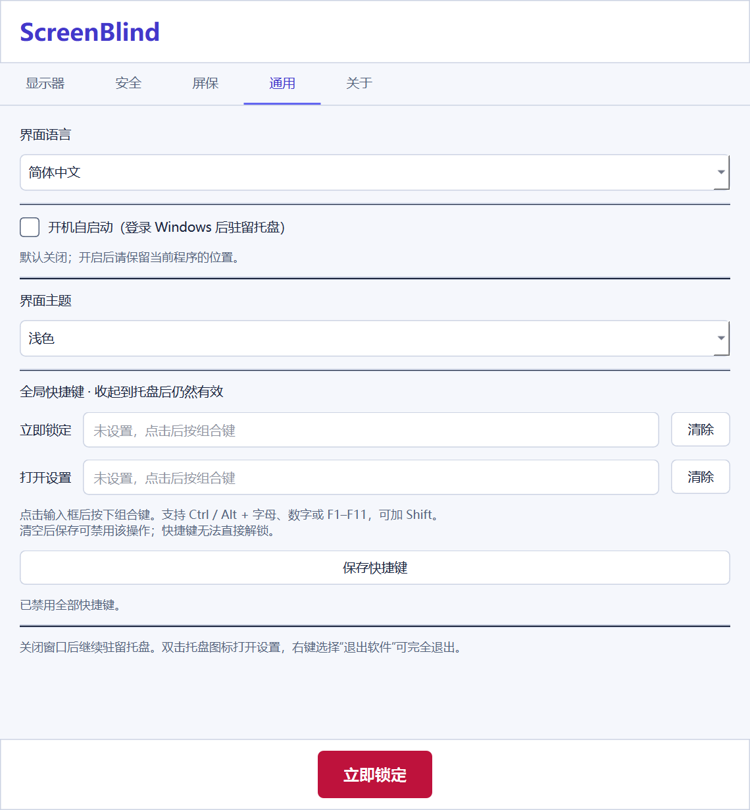

# ScreenBlind 中文增强版

基于 [hemigapp/ScreenBlind](https://github.com/hemigapp/ScreenBlind) 的 Windows 多显示器隐私遮挡工具，保留原项目 MIT 许可与作者署名。

增强版贡献者：**Lyle** · 联系邮箱：[zjkljd@163.com](mailto:zjkljd@163.com)。

## 本分支新增

- **托盘驻留**：关闭设置窗口后继续运行；解锁后自动回到托盘，不弹出设置窗口。双击托盘图标恢复窗口，右键菜单支持打开设置、立即锁定、退出软件。
- **全局快捷键**：默认全部为空，由用户自行设置，窗口收起后仍有效。在“通用”页修改或清空并保存；按键占用时会提示，保留原有有效快捷键。
- **开机自启动**：在“通用”页开启或关闭，默认关闭；开启后在登录 Windows 时驻留托盘，不弹出设置窗口。开启后请保留程序的位置。
- **空闲屏保开关**：在“屏保”页取消“空闲后自动启动屏保”可关闭，原有等待时长会保留。该功能仅控制锁屏后的屏保动画，不会自动锁定电脑。
- **密码匹配即解锁**：直接输入完整密码即可立即解锁，无需回车；输错可以退格修改，回车仍可用于手动校验。
- **语言切换**：在“通用”页选择跟随系统、简体中文或 English，即时生效并保存。设置页、托盘、提示框、锁屏及屏保提示随之切换，未提交的密码和快捷键草稿会保留。
- **浅色 / 深色主题**：在“通用”页即时切换并自动保存。锁屏与屏保保留深色背景，避免遮挡时突然亮屏。
- **单实例运行**：再次双击程序会唤回已有窗口，避免重复托盘图标及快捷键冲突。锁定期间不会打开设置或重复锁定。

| 深色主题 | 浅色主题 |
| --- | --- |
|  |  |

## 使用

1. 双击 `ScreenBlind.exe`。
2. 在“显示器”页勾选需要锁定的显示器，可用“识别显示器”查看编号。
3. 在“安全”页设置密码。
4. 点击“立即锁定”，或使用自行配置的全局快捷键。
5. 直接输入密码或点击锁屏后输入密码；密码完全匹配时立即解锁，无需按 Enter。首次按空格、Esc 或 Enter 时仅唤出密码框，不计入密码；直接输入字母、数字等字符时保留首字符。密码框打开后，空格正常参与密码输入，Esc 取消输入；输错可退格修改，或按 Enter 校验并清空错误输入。
6. 关闭设置窗口可收起到托盘。需要完全退出时，右键托盘图标选择“退出软件”。

全局快捷键支持 Ctrl 或 Alt 配合字母、数字、F1–F11，可叠加 Shift。不使用 Windows 键或 F12。快捷键只负责锁定和打开设置，**不能绕过密码解锁**。

配置保存在 `%APPDATA%\ScreenBlind\settings.json`，主题与快捷键会自动恢复，原版设置可以沿用。密码仅以 PBKDF2-SHA256 哈希保存在本地。首次快捷键注册失败时，可通过托盘打开“通用”页修改。升级会保留之前已经保存的快捷键；如需禁用，可清空后保存。开机自启动使用当前用户的 Windows Run 配置，无需管理员权限。

## 开发运行与打包

推荐使用官方 Python 3.12（64 位）创建独立环境；较旧 Anaconda 运行库可能无法加载新版 Qt。

```powershell
python -m venv .venv
.\.venv\Scripts\python.exe -m pip install -r requirements.txt pyinstaller
.\.venv\Scripts\python.exe main.py
```

双击 `build.bat` 或在独立环境中运行：

```powershell
.\.venv\Scripts\python.exe -m PyInstaller --noconfirm ScreenBlind.spec
```

生成文件：`dist/ScreenBlind.exe`。无需安装 Python 即可运行，保留原项目 Per-Monitor V2 DPI 声明。

```powershell
.\.venv\Scripts\python.exe -m unittest discover -s tests -v
.\.venv\Scripts\python.exe tests/native_hotkey_smoke.py
```

测试覆盖快捷键解析、冲突回滚、禁用 / 交换快捷键、托盘关闭恢复、配置持久化、主题切换、重复锁定保护、密码校验及单实例通信。测试使用临时配置，不覆盖个人设置，也不安装锁屏输入钩子。

## 边界

本软件用于屏幕内容遮挡，不能替代 Windows 系统锁屏。未锁定的显示器可继续显示内容，但锁定期间鼠标和键盘由锁屏接管。`Win+L` 与 `Ctrl+Alt+Del` 仍由 Windows 处理。

支持 Windows 10/11；多显示器混合 DPI、显示器热插拔、系统休眠恢复等情况仍建议在实际设备上验证。

[English](README.md) · [MIT 许可](LICENSE)
